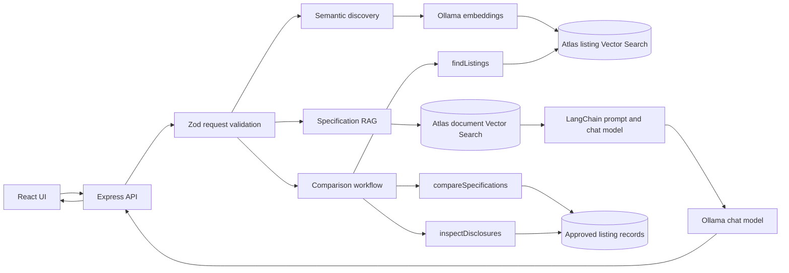
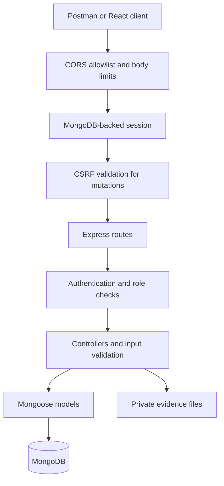
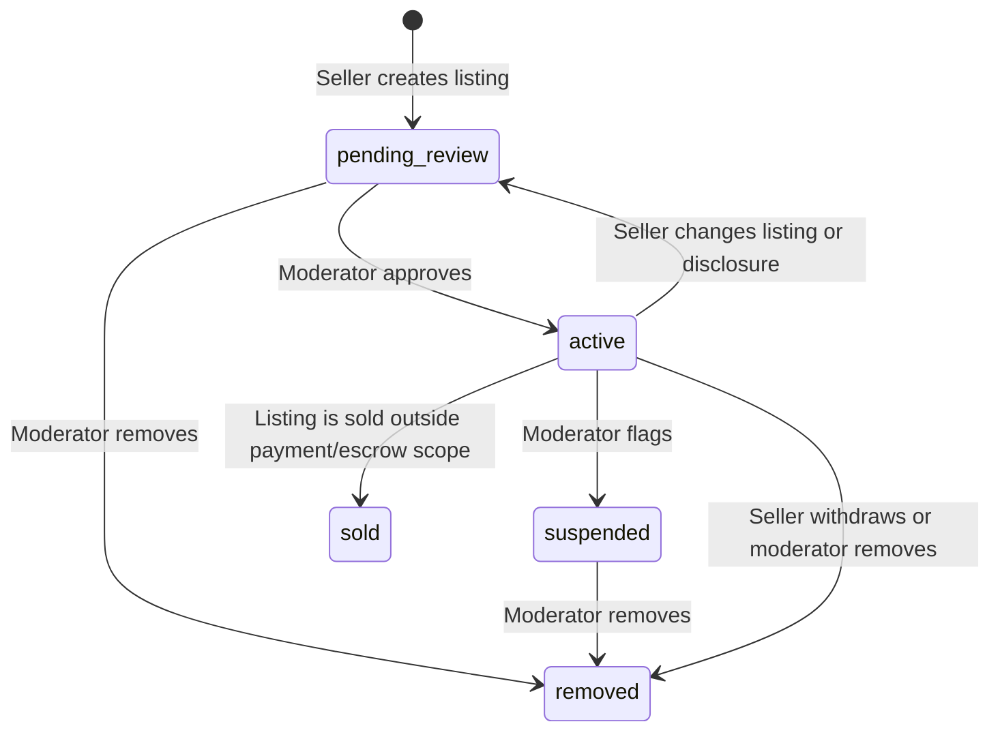

# Backend architecture and workflows

## AI data flow

Only active, moderator-approved listings are searched. Manufacturer source excerpts and seller excerpts explicitly shared with buyers are separately typed and cited. Private ownership evidence is never inserted into AI context.

## Request architecture

## Listing lifecycle

Only records with `status=active` and `moderationStatus=approved` are returned by public listing endpoints. Seller-authored condition disclosures remain separate from moderation decisions.

## Access boundaries

- Buyer: public approved listings, own shortlist/questions/viewings, and chat conversations in which the buyer participates.
- Seller: own listings and evidence, questions about own listings, viewing requests received for own listings, and replies to existing conversations.
- Moderator: moderation queue, reports, evidence review/download, moderation history, invitations, and membership administration.
- Public clients never receive evidence storage paths or the seller's `ownershipConfirmed` field.
